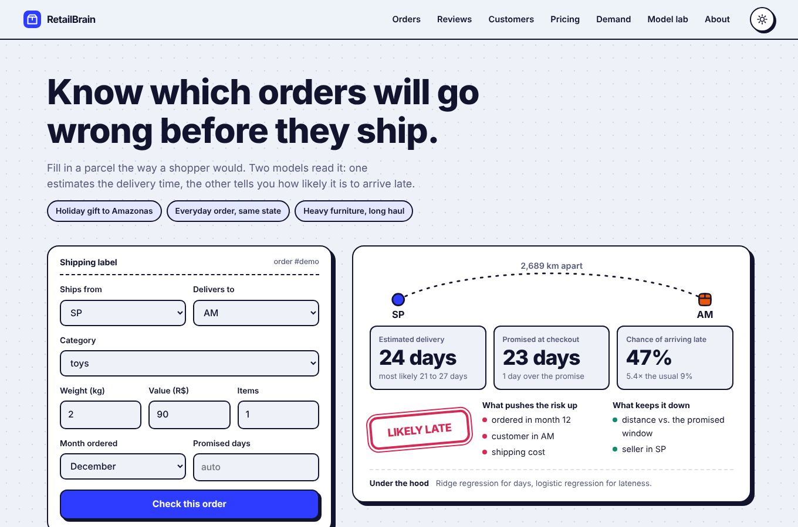
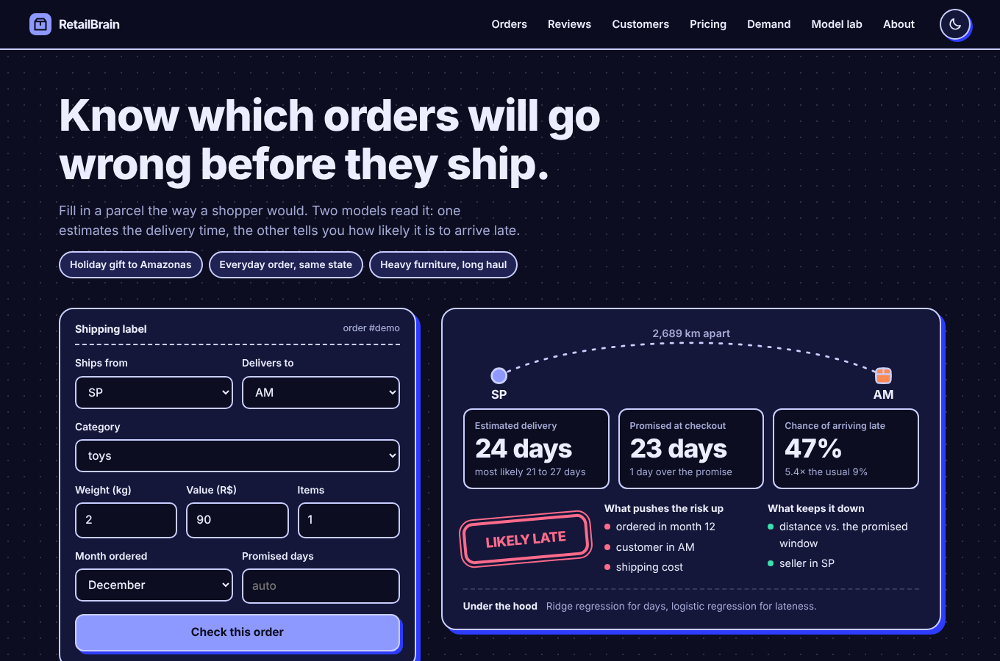

# RetailBrain

**An online store that sees its own problems coming.**

I wanted one machine learning project that showed I know *when* to reach for which algorithm, not ten unrelated notebooks. So I invented a small online store, gave it the usual headaches (late parcels, angry reviews, customers who never come back, coupons handed out blindly), and built the models a data team would build to deal with them. Then I put them behind a website you can actually click around in.

|  Light | Dark |
|---|---|
|  |  |

Everything runs on a plain Flask server. No JavaScript framework, no chart library, no database. It deploys as a single small web service.

---

## What's inside

Ten modules share one dataset and feed each other. Scores are on held-out data the models never saw.

| # | Question | Algorithms | Result |
|---|---|---|---|
| 1 | How many days will this order take? | Linear, Ridge, Lasso | Off by **1.85 days** on average (always guessing the mean: 4.01). R² 0.75 |
| 2 | Will it arrive late? | Logistic regression, compared with tree, random forest, XGBoost | ROC-AUC **0.73**. Flag the riskiest 10% of orders and you catch 35% of late ones (the base rate is 9%) |
| 3 | Which rules explain late orders? | Decision tree (depth 4) | Plain-English rules, e.g. *ordered in December, tight promised window, over 230 km: 53% late* |
| 4 | Will a first-time buyer come back? | Logistic, random forest, XGBoost, **tuned XGBoost** | ROC-AUC **0.69**. Contact the top 20% and you reach 39% of returners (1.96x better than random) |
| 5 | Is a review happy or angry? | Naive Bayes on TF-IDF (vs logistic) | **92%** accuracy |
| 6 | What kinds of customers do we have? | K-Means on recency, frequency, spend, plus PCA | 4 segments: Loyal Repeaters, Big Spenders, New & Fresh, Dormant Savers |
| 7 | What looks like this product? | K-nearest neighbours | 5 look-alikes, same category 99.9% of the time |
| 8 | What should we show this customer? | Collaborative filtering + popularity hybrid | Hit rate @10 of **31.6%** vs 23.3% for "most popular" and 1.3% random |
| 9 | Who deserves a coupon? | Thompson-sampling bandit | **+15%** profit vs no coupons, **+8%** vs 10% off for everyone, within ~2% of an agent with perfect knowledge |
| 10 | How much will we sell next week? | XGBoost vs a neural network (MLP) | XGBoost off by **19%**, the MLP by 23%, "same as last week" by 27% |

### How the modules talk to each other

- The sentiment model (5) scores every customer's first review, and that score becomes an input to the repeat-buyer model (4).
- Lateness (2) and review score both help predict who returns (4).
- K-Means segments (6) are the "customer types" the coupon agent (9) learns about.
- Segment and repeat odds show up together on the customer lookup, alongside recommendations from (7) and (8).

Open the **Model lab** section on the site to see every comparison table, the decision-tree rules, SHAP-style feature importances, and the PCA plot.

---

## Run it on your machine

You need Python 3.12 (3.11 should work too, but 3.12 is what I tested).

```bash
git clone <your-repo-url> retailbrain
cd retailbrain
python -m venv venv
source venv/bin/activate          # Windows: venv\Scripts\activate
pip install -r requirements.txt

python app.py                     # then open http://localhost:5000
```

The trained models are already in `models/`. If you want to rebuild them (about 30 seconds):

```bash
python train.py
```

Run the tests:

```bash
pip install -r requirements-dev.txt
pytest -q
```

---

## Deploy it

Pick whichever you like. All of them train the models during the build so the saved files always match the installed library versions.

**Render (easiest, free tier works)**
1. Push this folder to a GitHub repo.
2. On Render choose *New → Blueprint* and select the repo. `render.yaml` does the rest.
3. First load after a quiet spell can take about 30 seconds on the free tier while it wakes up.

**Docker (works anywhere: Fly.io, Railway, Google Cloud Run, a VPS)**
```bash
docker build -t retailbrain .
docker run -p 8000:8000 retailbrain      # http://localhost:8000
```
The container listens on `$PORT` if the host sets one, otherwise 8000. Hugging Face Spaces (Docker) expects port 7860, so set `PORT=7860` there.

**Heroku-style platforms**: the `Procfile` and `runtime.txt` are included.

A health check lives at `/health`.

---

## About the data (please read this part)

**The data is simulated.** The real Olist Brazilian e-commerce dataset needs a Kaggle login to download, so `src/data_gen.py` generates 18,804 orders from 15,000 customers across 600 products, shaped like Olist: seller and buyer states, distances, delivery dates versus promised dates, review scores and text, repeat purchases.

Cause and effect are written into the generator (distance and December slow deliveries, late parcels get bad reviews, happy first-time buyers return more often), then the models have to rediscover those patterns from noisy examples. That makes this a fair test of the *methods*, but the numbers above are **not findings about a real store**. A few things to know:

- The coupon agent's customers are a hand-built simulation (each segment gets its own price sensitivity). What's real is the learning: the agent only sees who bought.
- Review text is built from phrase templates with noise added (including reviews where the words and the stars disagree), so 92% is easier than real life.
- In the recommender, the tuning step found that item-similarity content features added nothing on top of collaborative filtering plus popularity, so the final blend weights content at zero. I left that in rather than hide it.
- The 4-week neural-network forecast wobbles because it extrapolates poorly on this little data. The chart shows only its held-out weeks, and XGBoost carries the forecast.

### Swapping in the real Olist data

The training script only needs four tables from `generate()`: `orders`, `customers`, `products`, `interactions`. To use real Olist data:

1. Download the dataset from Kaggle and put the CSVs in `data/raw/`.
2. Write a small loader that returns the same columns (the first lines of `generate()` and `_build_orders()` list them): merge orders, items, customers, sellers, products and reviews; compute `distance_km` from the geolocation table with the haversine formula already in `data_gen.py`; set `is_late` and `delivery_days` from the timestamps.
3. Olist has no browse events, so build `interactions` from `order_items`. Only about 3% of real customers buy twice, so expect the repeat-buyer scores to drop and the recommender to lean on popularity.
4. Reviews are in Portuguese. Naive Bayes will still work, since it learns whatever words it is given.
5. Run `python train.py` and everything else (API, website, tests) follows.

If you do this, update the "simulated" notes on the About section and in this README. It is a strong upgrade for the project.

---

## Project layout

```
retailbrain/
├── app.py                 Flask app: pages + JSON API
├── train.py               trains all 10 modules, writes models/ and artifacts.json
├── src/
│   ├── data_gen.py        simulated Olist-style data
│   ├── bandit.py          coupon-agent simulator (Thompson, epsilon-greedy, baselines)
│   ├── reco.py            hybrid recommender scoring
│   ├── config.py          feature lists shared by training and serving
│   └── utils.py           readable feature names
├── templates/index.html   the page
├── static/css, static/js  styling (light + dark) and front-end logic, hand-drawn SVG charts
├── models/                trained models + metrics (committed so the app starts instantly)
├── data/processed/        generated orders table
├── tests/test_api.py      endpoint + model sanity tests
├── Dockerfile  Procfile  render.yaml  runtime.txt  requirements.txt
└── docs/                  screenshots
```

### API at a glance

| Endpoint | What it does |
|---|---|
| `POST /api/order` | delivery days, late probability, reasons |
| `POST /api/review` | sentiment and the words that drove it |
| `GET /api/customer/<id>` | segment, repeat odds, coupon advice, recommendations |
| `GET /api/similar/<product_id>` | KNN look-alikes |
| `POST /api/pricing` | runs a fresh coupon-agent simulation |
| `GET /api/forecast/<category>` | weekly history, held-out predictions, 4-week forecast |
| `GET /api/lab` | every comparison table |

---

## Talking points for interviews

- **Why logistic regression for late orders when XGBoost is "better"?** Here it wasn't: logistic won (AUC 0.73 vs 0.70) because the signal is mostly additive, and it explains itself.
- **Why not accuracy?** Only 9% of orders are late, so "never late" scores 91% and is useless. I used ROC-AUC, PR-AUC and "how many late orders do you catch if you flag the top 10%".
- **Why a random split for delivery models?** A time split would leave the Nov/Dec peak out of the test window.
- **Why Thompson sampling over A/B testing?** It shifts traffic towards winners while it learns, instead of wasting half the customers on the loser.
- **What would break in production?** Late-delivery features like the promised window are known at checkout, but a real system also needs drift monitoring and a data pipeline.

## Resume lines you can adapt

Use the numbers from your own run, and say the data is simulated (or swap in real Olist data first).

- Built **RetailBrain**, an end-to-end ML platform on 18,800 simulated e-commerce orders combining linear/Ridge/Lasso regression, logistic regression, decision trees, random forest, XGBoost, Naive Bayes, K-Means, KNN, a hybrid recommender, a Thompson-sampling bandit and an MLP; deployed as a Flask web app with a light/dark UI.
- Reduced delivery-time error from 4.0 to 1.85 days (R² 0.75) and flagged late orders with ROC-AUC 0.73, catching 35% of late parcels by reviewing only the riskiest 10% of orders.
- Tuned XGBoost with randomized search (3-fold CV) to reach 1.96x lift over random for repeat-buyer targeting; explained predictions with SHAP values.
- Designed a coupon bandit that lifted simulated profit 8% over a flat 10% discount and 15% over no coupons.
- Wrote an API test suite and a Docker/Render deployment; trained models rebuild automatically at build time.

---

Built as a portfolio project. MIT licensed: change the name in `LICENSE` to yours.
